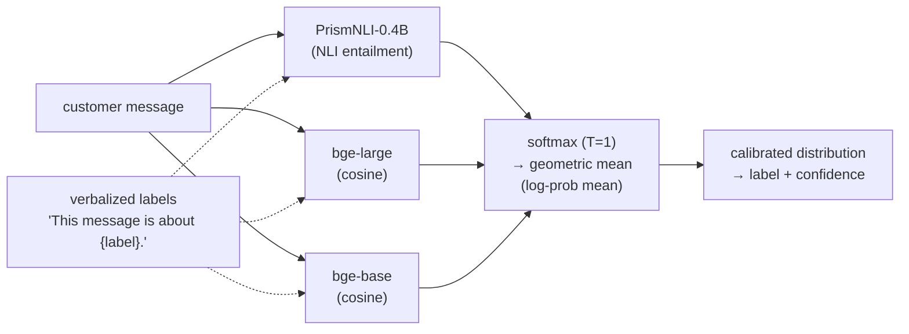
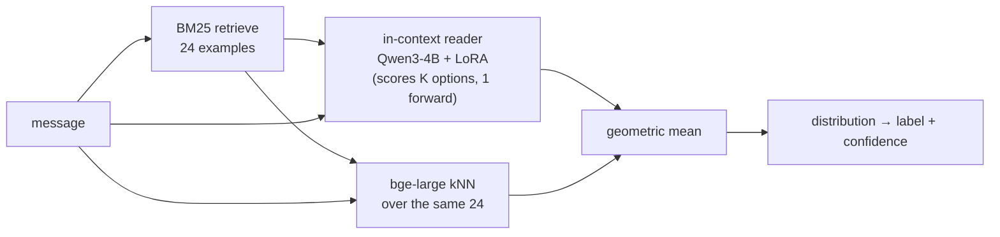

# Quorum

**A jury of tiny open models that vote — and tell you how sure they are.**

Can an ensemble of tiny open models match — or beat — a paid, closed "calibrated decision" API on intent
classification? Two honest results, both on public benchmarks, both with paired significance tests.

**Links:** [🤗 Quorum collection](https://huggingface.co/collections/DataAgent/quorum-6abb3255e0fab20d66add39b) ·
[live demo (Space)](https://huggingface.co/spaces/DataAgent/Quorum-Demo) ·
[gated 24-shot adapter](https://huggingface.co/DataAgent/Quorum-Reader-Qwen3-4B-Adapter)

> The demo is a static frontend that calls a Quorum API you self-host (see [`serve/`](serve/)) — free, and the
> inference stays on your machine.

This repo accompanies a small reproduction study. The comparison target is **Jev**, a closed commercial
calibrated-decision model. On the standard **Banking77** intent benchmark (77 classes, full 3,080-item test):

1. **Zero-shot — clearly behind Jev, with models that fit on a laptop.** A geometric-mean ensemble of three
   sub-1B open models — `Jaehun/PrismNLI-0.4B` + `BAAI/bge-large-en-v1.5` + `BAAI/bge-base-en-v1.5` — scores
   **0.774** when each class is given a one-line plain-language *description* (a rephrasing of the label name that
   anyone can write; nothing is taken from the dataset), and **0.756** with bare class names. Both are **no
   training, no calibration**, and run on a CPU (≈120 ms/item on a GPU; ~1.5–2 s for a handful of labels on a CPU).
   But the NLI member's base model was trained on the Banking77 train split, so these numbers are not fully held
   out: with an NLI member never trained on Banking77 the ensemble scores **0.716**. Jev, measured by us through
   its API on the same sentences and label text, scores **0.803**, and it is ahead on all five benchmarks we
   measured (by 3.4–22.7 points).
2. **24-shot — level with Jev, with a 4B reader.** Given 24 retrieved examples per query and **no weight
   update**, an open ensemble (a 4B in-context reader + a nearest-neighbour over the same 24) scores **0.932** on
   the full test, reproducible in this repo, against **0.924** for Jev in a public reproduction's setup — not a
   significant difference (paired McNemar p = 0.066). Given the *same* retrieved examples the two tie (0.936 vs
   0.935, p = 0.87): most of the open stack's edge comes from retrieval, not from the models. This is not the
   CPU jury — the reader has 4B parameters. See *provenance* below.

> **What this is *not*.** This is not a claim of open zero-shot state-of-the-art. Our baseline throughout is
> *our own* sub-1B components; a 7–9B open LLM will beat our zero-shot *absolute* accuracy on some datasets
> (e.g. reported ~0.84 on CLINC vs our 0.65). The point is different: **a cheap, calibrated-by-design ensemble
> reliably beats its own strongest part, across domains** — and, at the 24-shot budget with a 4B reader, matches a
> paid closed API. **Licences differ by component:** the code is MIT; the default NLI member's base model was trained
> partly on data with non-commercial licences, so check each model's terms before commercial use.

## How it works

Zero-shot — three complementary members vote, geometric mean, done (no training, no calibration):



24-shot — retrieve 24 examples, two mechanisms read the *same* 24, geometric mean (the pipeline that ties
Jev; adapter release pending):



## The zero-shot method (fully reproducible here)

No single small model is a great zero-shot intent classifier. But three *complementary* ones — one NLI model
(reads the message against "This message is about {label}.") and two sentence embedders (cosine to the same
verbalized labels) — disagree in useful ways. Softmax each at temperature 1, take the **geometric mean**
(log-probability mean), renormalise. No labels, no training, no per-task calibration.

```python
from quorum import ZeroShotEnsemble
clf = ZeroShotEnsemble(device="cpu")
labels = ["card arrival", "card delivery estimate", "lost or stolen card", ...]
name, confidence, dist = clf.predict("when will my new card arrive?", range(len(labels)), label_texts=labels)
```

On Banking77 (full 3,080 test) the ensemble beats every single member by a clear, significant margin (paired
McNemar p < 0.001, b = 223 / c = 65). With bare class names (single members shown for the ensemble-beats-parts
property), and with generic one-line descriptions:

| system | accuracy |
|---|---|
| `PrismNLI-0.4B` alone (names) | 0.704 |
| `bge-large` alone (names) | 0.700 |
| `bge-base` alone (names) | 0.672 |
| **ensemble — bare names (zero authoring)** | **0.756** |
| **ensemble — + generic descriptions** | **0.774** |
| ensemble — descriptions, NLI member never trained on Banking77 † | 0.716 |
| *Jev (measured via its API, `jev-1.13.0`, same descriptions)* | *0.803* |

Both ensemble numbers are reproduced in this repo on the full test. Reproduce:
`python scripts/eval_zeroshot.py --dataset banking77 --device cpu` (names; ≈120 ms/item on GPU), or pass the
descriptions from `examples/banking77_descriptions.py` as `label_texts` for the 0.774 row. Jev leads zero-shot by
a wide margin; the open stack only ties it at the 24-shot budget, with a 4B reader (below).

† The default NLI member's base model saw the Banking77 train split (Trap 2 below), so the 0.756/0.774 rows are not
fully held out. With an NLI member never trained on Banking77 (`MoritzLaurer/deberta-v3-large-zeroshot-v2.0-c`), the
ensemble no longer beats its best member on Banking77 (0.690 vs 0.700 with names, n.s.; 0.716 vs 0.738 with
descriptions).

### Optional: descriptions instead of names (the "+quality" path)

The default matches against bare label *names* — zero authoring. When names are short or opaque, a one-line
*description* per class carries far more signal, and the ensemble already takes it: pass `label_texts` the
descriptions instead of the names (the returned label stays whatever you pass as `labels`). No extra code, no
extra model.

```python
descriptions = ["adding a song to a playlist", "reserving a table at a restaurant", ...]
name, conf, dist = clf.predict(text, labels, label_texts=descriptions)   # match on descriptions, return names
```

Measured, full test, same 3-model ensemble, names → descriptions:
**Banking77 0.756 → 0.774** (+0.018); **SNIPS 0.853 → 0.944** (+0.091, above the description-based "dataless"
method's reported 0.926); **CLINC150 0.652 → 0.682** (+0.030) — all McNemar p < 1e-6. The gain scales with how
opaque the class *names* are: large on SNIPS (short, ambiguous names), smaller on Banking77/CLINC (names
already fairly descriptive; a one-line description doesn't fully close the gap to specialised methods on the
151-intent CLINC). See `examples/{banking77,snips,clinc}_descriptions.py` for the exact descriptions, and
`docs/phases/1.1/` for the write-up. Descriptions are the recommended path when you have them; names remain the
zero-effort default.

## Does it generalize beyond Banking77?

The "ensemble beats its own best member" property holds across six different-domain intent datasets
(full official test, paired McNemar vs the best single member):

| dataset | classes | ensemble | best single | verdict |
|---|---|---|---|---|
| MASSIVE | 60 | 0.739 | 0.691 | ✅ win (p<.001) |
| MTOP | 113 | 0.614 | 0.587 | ✅ win (p=5e-5) |
| Bitext customer-support | 27 | 0.775 | 0.712 | ✅ win (p<.001) |
| CLINC150 | 151 | 0.652 | 0.630 | ✅ win (p<.001) |
| HWU64 | 64 | 0.739 | 0.643 | ✅ win (p<.001) |
| SNIPS | 7 | 0.853 | 0.868 | ➖ tie (p=0.06, ns) |

**5 significant wins of 6.** The exception (SNIPS, 7 classes, near-saturated): the ensemble is slightly *lower*
than the best single member but not significantly (p ≈ 0.06). It is honest and instructive — when the label set
is tiny and one member is already excellent, averaging in weaker members stops helping. Ensembling pays off
where the label space is large and the components are complementary. (Every number here is what this repo
prints on the full official test set.) MASSIVE and HWU64 are not fully held out for the NLI member (Trap 2);
with an NLI member never trained on intent data, the ensemble still beats its best member in all eight
conditions (names and descriptions) on the four benchmarks with no known exposure: CLINC150, MTOP, SNIPS and
Bitext.

## The 24-shot method (level with Jev)

At the 24-shot setting of the public Jev reproduction (retrieve 24 examples per query with BM25, read them in-context, never update
weights), we ensemble two mechanisms over the *same* 24 examples: a 4B open reader (`Qwen3-4B` with a small
LoRA fine-tuned on **other public intent datasets, Banking77 excluded**) that scores all classes in one forward
pass, and a frozen `bge-large` nearest-neighbour, geometric mean.

**On the Jev numbers (provenance).** TypeSafe's *official* Jev evaluation is on their own private 4-workflow
suite, **not** on public academic benchmarks — there is no official Jev Banking77 number. The community
reproduction's figure (simonmesmith's; 2846/3080 = 92.40%) is exactly what Jev scores when we send the
reproduction's own requests to its API (`jev-1.13.0`). Every other Jev number here was measured by us through its
API on the same test sentences and label text, after all of our configurations were frozen; Jev's outputs were
used only for evaluation, never for training or tuning.

**Reported honestly:**
- **This repo reproduces 0.932** on the full 3,080 test (default config: class names only, no calibration),
  against **0.924** for Jev in the reproduction's setup — **not a significant difference** (paired McNemar
  p = 0.066). Reproduce:
  `python scripts/eval_24shot.py --dataset banking77 --adapter DataAgent/Quorum-Reader-Qwen3-4B-Adapter` (the
  adapter is gated on the Hub — request access).
- **A pre-registered single test run scored 0.936** (p = 0.014 against the reproduction's setup). Given the
  *same* retrieved examples, Jev scores 0.935 and the two **tie** (p = 0.87); Jev gains +1.07 points from our
  retrieval rule (p = 6.7e-5). So the edge comes mainly from retrieval, not from the models.
- An earlier exploratory configuration reached 0.938, but about 40 configurations were scored on the test set
  along the way, so it is **not reported as a result**.

The adapter (`DataAgent/Quorum-Reader-Qwen3-4B-Adapter`) is a LoRA on Qwen3-4B trained only on public intent
datasets with Banking77 held out. It is **contaminated** for datasets *inside* its training mix (CLINC/HWU/
SNIPS), so don't use it to judge zero-shot generalization on those.

## What did **not** work (also measured)

Negative results, so you don't repeat them:

- **More training data saturates.** Scaling the reader's fine-tuning from ~23K to ~60K examples did not raise
  zero-shot accuracy (flat around 0.70).
- **A bigger embedder does not help.** Swapping `bge-large` for `Qwen3-Embedding-8B` (top of the MTEB
  leaderboard) made the nearest-neighbour member *weaker* on this task — leaderboard rank is not task rank.
- **Reranking the top-k does not help.** A cross-encoder reranker and even a small generative "reasoning"
  reader over the ensemble's top-5 candidates both fail to beat the ensemble's own calibrated ranking.

## Five ways we caught *ourselves* getting it wrong

The methodology is the point. Traps we hit and fixed (each flipped a conclusion):

1. **Smoke-test inflation.** A 100-item smoke read 0.94 on SNIPS; the full 1,400-item test was 0.85. Only
   full-test numbers appear here.
2. **Contaminated "zero-shot".** A popular zero-shot NLI model lists Banking77 in its own training data — its
   "zero-shot" number is not zero-shot. We switched to `PrismNLI-0.4B` — and later found its *base* model was
   trained on the Banking77 and MASSIVE train splits too (contamination through model lineage). Those zero-shot
   results are therefore marked "not fully held out"; with an NLI member never trained on intent data, Banking77
   drops to 0.716.
3. **Mismatched budgets.** Comparing a zero-shot system to a fully-supervised leaderboard number is not a
   comparison. Everything here is matched-budget.
4. **Unpaired tests.** When two systems predict on the same items, the paired McNemar test is the correct one —
   it needs a far smaller margin than an unpaired aggregate comparison.
5. **Selection on the test set.** An early 0.938 came from ~40 configurations scored on test. The 24-shot
   headline is now a pre-registered single test run (0.936), with every rule/weight/temperature chosen on
   held-out data.

## Reproduce

```bash
pip install -r requirements.txt
python scripts/eval_zeroshot.py --dataset banking77 --device cpu    # or --device cuda
```

First run downloads the three open models (~1 GB) and the dataset. All numbers here are from the full official
test sets.

## Roadmap

- [x] Zero-shot ensemble + reproduction (this repo).
- [x] 24-shot pipeline (in-context reader + kNN) + gated adapter (`DataAgent/Quorum-Reader-Qwen3-4B-Adapter`).
- [ ] A tiny FastAPI wrapper (import `quorum`) for a self-hosted service.

## Models used (all public)

`Jaehun/PrismNLI-0.4B` · `BAAI/bge-large-en-v1.5` · `BAAI/bge-base-en-v1.5` · `Qwen3-4B` (24-shot reader).
See each model card for its own license.

## License

Code: MIT (see `LICENSE`). The datasets and models retain their own licenses.
